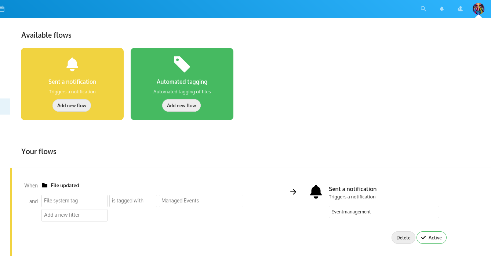
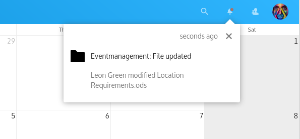

<!--
  - SPDX-FileCopyrightText: 2020 Nextcloud GmbH and Nextcloud contributors
  - SPDX-License-Identifier: AGPL-3.0-or-later
-->
# 🔔 Notifications for Nextcloud Flow

The Flow Notifications app adds a **Send a notification** action to Nextcloud Flow. It automates generating customized notifications for events that match configured rules.

Choose an event and conditions, and optionally provide a title prefix to help identify the resulting notification.

## How it works

When personal flows are enabled, users can configure notification rules
in their personal Flow settings.

Each rule group combines its conditions with AND: the group matches only when
all its conditions match. Each matching group can trigger a notification.
Events include file activity and tag assignment; conditions include MIME
type, time ranges, upload size, and more.

For example, configure a flow for the **File updated** event with a MIME
type condition of `application/pdf` and the optional title "PDF updated".
When another user updates a matching PDF you can access, your flow can
notify you.

## Considerations

- Notifications are skipped when the current session user is the flow owner.
  For example, updating a file in your own session will not notify you
  through your own flow.
- Ensure that the [Notifications](https://github.com/nextcloud/notifications)
  app is installed and enabled. It is required for Flow Notifications to
  register its action.
- The notification action is available for personal flows, not administrator-scoped flows.

For general configuration guidance, see the [Nextcloud Flow documentation](https://docs.nextcloud.com/server/stable/go.php?to=admin-workflowengine). Discover more about Nextcloud Flow at [https://nextcloud.com/workflow](https://nextcloud.com/workflow).

## 🏗 Developing

1. ☁ Clone this app into the `apps` folder of your Nextcloud: `git clone https://github.com/nextcloud/flow_notifications.git`
2. 👩‍💻 In the folder of the app, run the command `npm ci && npm run dev` to install dependencies and build the Javascript.
3. ✅ Enable the app through the app management of your Nextcloud
4. 🎉 Partytime! Help fix [some issues](https://github.com/nextcloud/flow_notifications/issues) and [review pull requests](https://github.com/nextcloud/flow_notifications/pulls) 👍

### 🧙 Advanced development stuff

To build the Javascript whenever you make changes, you can also use `npm run build`. Or `npm run watch` to automatically rebuild on every file save.

## ♥ How to create a pull request

This guide will help you get started:
- 💃 [Opening a pull request](https://opensource.guide/how-to-contribute/#opening-a-pull-request)

## ✌ Code of conduct

The Nextcloud community has core values that are shared between all members during conferences, hackweeks and on all interactions in online platforms including [Github](https://github.com/nextcloud) and [forums](https://help.nextcloud.com). If you contribute, participate or interact with this community, please respect [our shared values](https://nextcloud.com/code-of-conduct/). 😌
